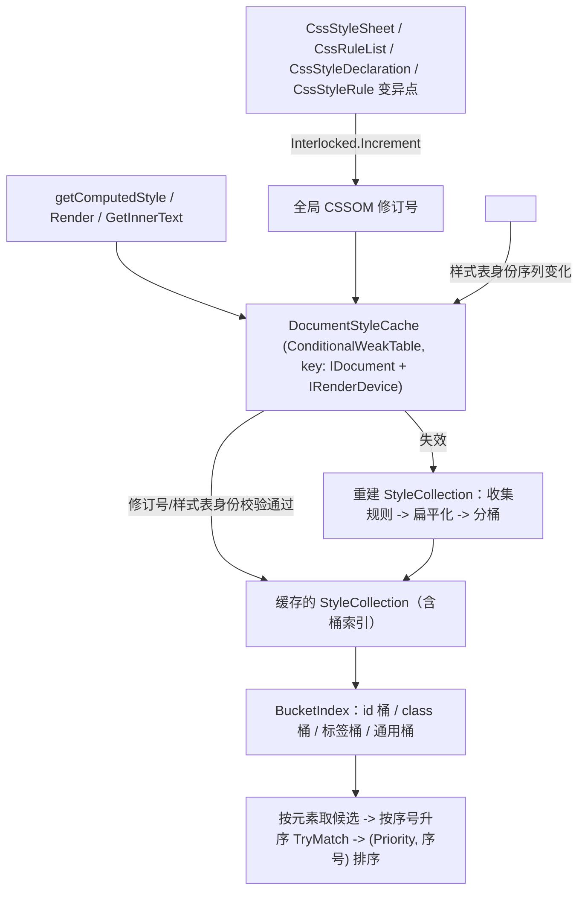

## 产品概述
为 AngleSharp.Css 的样式计算（cascade 规则匹配）引入「关键选择器分桶索引」：把样式规则按最右侧复合选择器的本质键（id / class / 标签）预先分桶，元素求样式时只取命中的候选桶，替代当前「对每条规则线性比对」的做法。索引在文档级缓存并跨调用复用，供 `getComputedStyle`、整树渲染、`innerText` 三条路径共享。

## 核心功能
- **规则分键**：为每条样式规则计算并缓存关键选择器键；无法明确判定键的规则一律归入「通用桶」，保证不漏匹配。
- **分桶索引构建**：按规则在文档中的遍历顺序扁平化（含嵌套规则），建立 id 桶、class 桶、标签桶与通用桶，桶内保留原始顺序序号。
- **候选查询与匹配**：按元素自身的 id、class 集合、标签取出候选规则，按文档顺序归一后仍按「选择器优先度升序 + 同优先度按文档先后」得出最终声明顺序。
- **文档级缓存与失效**：同一文档 + 同一渲染设备的索引与规则集合跨调用复用；样式表/规则/声明被增删改、样式表被禁用、样式表节点增删、媒体求值所依赖的设备变化时，索引自动失效并重建。
- **三条路径统一生效**：单元素求样式、整文档渲染树构建、元素 `innerText` 计算均走同一份缓存索引。
- **行为完全一致**：所有既有样式计算结果保持不变，包含嵌套规则、选择器列表（逗号分组）、强制伪类状态、同优先度的先后顺序、媒体规则过滤等边界语义。

## 视觉/可观测效果
无界面变化。可观测结果是：样式匹配耗时与内存分配显著下降，`getComputedStyle`、渲染树、`innerText` 三条基准均有可量化的提速对比数据；在需要时修改样式表后立即重新求样式，结果仍与修改前逻辑一致。


## 技术栈
- 语言/运行时：C#，库项目 `AngleSharp.Css`（`netstandard2.0`），测试 `net8.0`，性能基准 `net472;net10.0`。
- 约束：不新增第三方依赖；`Nullable=enable`、`LangVersion=latest`、**`TreatWarningsAsErrors=true`（必须零警告）**、`SignAssembly=true`。
- 依赖的核心侧选择器模型（本地源码 `d:/_git4/Hutu/deps/AngleSharp/src`）：`ISelector` / `ISelectorVisitor`（`Type`/`Id`/`Class`/`List`/`Combinator`/`Many`）、`CompoundSelector`、`ComplexSelector`、`ListSelector`、`TypeSelector`/`ClassSelector`/`IdSelector`/`AllSelector`/`NamespaceSelector`/`NestedSelector`、`Priority`。

## 实现方案

### 核心策略
桶只是**必要条件的超集过滤**：一条规则的最右侧复合选择器中的所有简单选择器是「与」关系，任意一个都成立才是必要条件。因此按其中任一简单选择器分桶，命中的元素必然是规则可能匹配的元素子集，绝不会漏。

### 关键判定：什么键可以被安全使用
从核心源码确认的 visitor 回调来源：

| 回调 | 触发者 | `Specificity` | 可否作键 |
|---|---|---|---|
| `Id(v)` | `IdSelector` | `OneId` | 可（`element.Id.Is(v)`，Ordinal） |
| `Class(v)` | `ClassSelector` | `OneClass` | 可（`TokenList.Contains`，Ordinal） |
| `Type(v)` | `TypeSelector` | `OneTag` | 可（`v.Isi(element.LocalName)`，忽略大小写） |
| `Type("*")` | `AllSelector` | `Zero` | 不可 |
| `Type(prefix)` | `NamespaceSelector` | `Zero` | 不可（`MatchesCssNamespace`，语义不同） |
| `Type("&")` | `NestedSelector` | `OneClass` | 不可 |
| — | `ReferencedNestedSelector.Accept` 为空 | — | 提取不到键 → 通用桶 |

**安全规则**：仅当「来源简单选择器的 `Specificity == Priority.OneTag` 且名字不是 `*`/`&`」时才生成标签键；仅 `Id`/`Class` 回调生成 id/class 键。**任何不确定形态（含提取不到、命名空间、嵌套引用）一律落通用桶。** 这样标签桶也被证明是安全的（`*|div`、`ns|div` 的右端仍是真正的 `TypeSelector("div")`，标签键 `div` 是必要条件）。

### 桶键的稳定性
- 桶字典比较器必须与匹配语义逐字对齐：**id 桶与 class 桶用 `StringComparer.Ordinal`**（`StringExtensions.Is` 为 Ordinal，`TokenList.Contains` 为 Ordinal），**标签桶用 `StringComparer.OrdinalIgnoreCase`**（`TypeSelector.Match` 用 `Isi`）。
- 最右侧关键复合选择器的定位：`ComplexSelector.Accept` 走 `visitor.Combinator(selectors, symbols)`，`selectors` 为**左→右**，取**最后一个**；`ConcludeSelector` 不经过 `combinator.Change` 包装（`Change` 仅 `NamespaceCombinator` 改写、且只作用于非末端），因此末端即原始复合选择器。
- 选择器列表：`ListSelector.Accept` 走 `visitor.List(selectors)`，需对列表中**每个**选择器分别提取键，规则进入多个桶。
- 键在规则侧一次性计算并缓存，随 `ChangeSelector` / `SelectorText` setter / `ReplaceWith` 失效（与既有 `_selectorList` 缓存同址，复用同一 `ISelectorVisitor` 机制），避免每次匹配重走选择器结构。

### 顺序与嵌套语义的保持（关键决策）
现状 `MapPriority` 的索引 `matches.Count` 等价于「DFS 访问顺序中已命中规则的排名」，`RuleMatchComparer` 以 `(Priority, Index)` 做稳定排序。若直接对顶层规则剪枝，会漏掉嵌套子规则。

**方案**：在 `StyleCollection` 中把规则按 `MapPriority` 的 DFS 顺序（父在前，`rule.Rules` 中 `ICssStyleRule` 子规则按序）**扁平化为列表并赋稳定序号**，对扁平列表逐条分桶。匹配时按序号升序访问候选、命中即记录，最终 `List.Sort(RuleMatchComparer)`。因候选访问顺序 = 原 DFS 顺序的子序列，`matches.Count` 排名与现状**逐位一致**；子规则独立成条目后仍由 `CssStyleRule.TryMatch` 自身的父链校验保证语义（`_nested=true` 的 `&` 引用也正确）。剪掉规则的前提是其右侧关键简单选择器不可能匹配，故安全。

### 文档级缓存与失效
- 缓存位置：静态 `ConditionalWeakTable<IDocument, DocumentStyleCache>`（对齐既有 `RenderTreeBuilder._windowRenderTrees` 与 `PseudoClassStateStore` 先例），条目内含按 `IRenderDevice` 区分的 `(修订号, StyleCollection)`。`IRenderDevice` 必须入键：`sheet.Media.Validate(device)`、`@media`/`@supports` 求值都依赖它。
- 失效来源一（CSSOM 侧）：全局单调「CSSOM 修订号」，在变异点自增——`CssStyleSheet.IsDisabled` setter / `Add` / `Remove` / `RemoveAt` / `Insert`，`CssRuleList.Add` / `AddRange` / `Insert` / `Remove` / `RemoveAt` / `Clear`，`CssStyleDeclaration` 属性增删改，`CssStyleRule.ChangeSelector` / `SelectorText`，`MediaList` 与 `CssRule` 相关可变点。
- 失效来源二（DOM 侧）：`document.GetStyleSheets()` 是惰性 DOM 遍历，`<style>`/`<link>` 增删不产生 CSSOM 变异，故额外做「样式表身份序列」比对（只比引用，判定即失效）。
- **安全兜底**：任何校验失败或不确定都退化为「重建」，最坏情况与现状同性能，因此不会比当前更慢。
- 三处调用点统一改为取缓存 collection：`WindowExtensions.GetComputedStyle`（当前每次新建）、`RenderTreeBuilder.CreateStyleCollection`、`ElementExtensions.GetInnerText` 内的 `window.GetStyleCollection`。
- 公共 API 面不变：`ComputeExplicitStyle`/`ComputeDeclarations`/`GetDeclarations`/`ComputeCascadedStyle` 仍为 public static 扩展，`IStyleCollection` 接口不动；非 `StyleCollection` 实现继续走原线性路径（现有 `styles is StyleCollection` 分支已提供该回退位）。

### 复杂度
令 R = 规则数、E = 参与计算的元素数、C = 元素命中的候选规则数（通常 ≪ R）。匹配由 O(R) 降为 O(C)（+ 索引构建一次性 O(R)）。`GetInnerText` 的 11.35s 用例中绝大多数规则右侧是 `.item-K` 类键，`C` 从约 2400 降到个位数，是最大受益点。

### 性能与可靠性补充
- 候选合并避免 `HashSet` 分配：按序号有序小数组归并 + 相邻去重（同规则可能命中多个桶）。
- 索引构建仅走扁平列表一次、分桶一次，不重复遍历选择器结构（键已在规则侧缓存）。
- `GetInnerText` 若在桶索引后仍明显落后（其每元素还会执行全属性 `.Compute(context)`），**仅在确认有收益且不改变语义时**再评估「按 innerText 所需属性短路计算」的后续优化，本次不默认引入。

## 架构设计



## 目录结构
```
d:/_git4/Hutu/deps/AngleSharp.Css/src/
├── AngleSharp.Css/
│   ├── Dom/Internal/
│   │   ├── SelectorKeyIndex.cs                     # [NEW] 桶键模型（None/Id/Class/Tag）+ 提取用 ISelectorVisitor。
│   │   │                                           #   复用核心 CompoundSelector.Many / ComplexSelector.Combinator（取末端）/ ListSelector.List（逐个）。
│   │   │                                           #   安全规则：Id 回调->Id 键；Class 回调->Class 键；Type 回调仅当来源 Specificity==Priority.OneTag 且名字非 "*"/"&" 时->Tag 键；其余->None。
│   │   │                                           #   提供 Extract(ISelector) -> 去重后的键集合（支持逗号列表返回多键）。
│   │   ├── StyleRuleBucketIndex.cs                  # [NEW] 桶索引：从扁平规则列表构建 id/class/Ordinal、tag/OrdinalIgnoreCase、universal 四类桶，
│   │   │                                           #   每项记录规则引用 + 稳定序号。查询 CollectCandidates(element) 用有序归并去重返回候选，
│   │   │                                           #   不做任何分配放大（避免 HashSet）。非 CssStyleRule 实现一律入 universal。
│   │   ├── DocumentStyleCache.cs                    # [NEW] 文档级缓存 + 失效：ConditionalWeakTable<IDocument, DocumentStyleCache>，
│   │   │                                           #   按 IRenderDevice 存 (revision, StyleCollection)；比对全局 CSSOM 修订号 + 样式表身份序列；
│   │   │                                           #   失败即重建（安全兜底）。暴露 GetStyleCollection(document, defaultSheets, device)。
│   │   ├── CssMutationRevision.cs                   # [NEW] 全局单调修订号（volatile long + Interlocked.Increment），供各 CSSOM 变异点调用。
│   │   ├── StyleCollection.cs                       # [MODIFY] 持有 StyleRuleBucketIndex（惰性构建，与 GetRules() 同址）；
│   │   │                                           #   新增内部候选查询入口；保留对非 StyleCollection 实现的回退语义。
│   │   ├── Rules/CssStyleRule.cs                    # [MODIFY] 缓存桶键（懒计算 + ChangeSelector/SelectorText/ReplaceWith 失效），
│   │   │                                           #   复用既有 ISelectorVisitor 缓存先例（_selectorList）。
│   │   ├── CssStyleSheet.cs                         # [MODIFY] IsDisabled setter / Add / Remove / RemoveAt / Insert 处打修订号。
│   │   ├── CssRuleList.cs                           # [MODIFY] Add / AddRange / Insert / Remove / RemoveAt / Clear 处打修订号。
│   │   └── CssStyleDeclaration.cs                   # [MODIFY] 属性增删改（SetProperty/RemoveProperty/CssText 等）处打修订号。
│   ├── Extensions/
│   │   ├── StyleCollectionExtensions.cs             # [MODIFY] SortBySpecificity 改为走桶候选（按序号升序遍历），
│   │   │                                           #   RuleMatchComparer 与 (Priority, Index) 语义逐位保留；非 StyleCollection 分支不动。
│   │   ├── WindowExtensions.cs                      # [MODIFY] GetComputedStyle 改用 DocumentStyleCache 取 collection（不再每次新建）。
│   │   └── ElementExtensions.cs                     # [MODIFY] GetInnerText 内的 window.GetStyleCollection 改走缓存路径。
│   └── RenderTree/RenderTreeBuilder.cs              # [MODIFY] CreateStyleCollection 改用 DocumentStyleCache（整树共用一份索引）。
├── AngleSharp.Css.Tests/
│   └── Styling/SelectorBucketing.cs                 # [NEW] 回归测试（见下）。
├── AngleSharp.Performance.Css/                      # 夹具不改动，仅复测。
└── perf-cascade.md                                  # [MODIFY] 追加桶优化前后对比数据（含 ComputedStyle / RenderTree / InnerText）。
```

## 实施注意
- **正确性优先于收益**：任何「拿不准是否必要条件」的规则都必须落通用桶；宁可少剪枝也不能漏匹配。
- **顺序语义**：从多桶合并候选后必须**先按文档序号归一**再 `TryMatch`，否则 `RuleMatchComparer` 的同优先度 tie-break 会与现状不同。
- **比较器必须与匹配语义一致**：id/class → Ordinal；tag → OrdinalIgnoreCase。用错比较器会造成静默错配。
- **`TreatWarningsAsErrors`**：新增内部类型与 `Nullable=enable` 的注解要完整，避免 CI/本地构建因警告失败。
- **失效点不要打在计算热路径上**：`SetDeclarations`/`UpdateDeclarations` 被 `ComputeExplicitStyle` 每元素调用，属于计算内部使用，**不应**视作外部变异而打修订号（只覆盖对外可观察的声明变更入口），否则缓存会自失效。
- **回退路径保留**：非 `StyleCollection` 的 `IStyleCollection` 实现（如测试/第三方）继续线性匹配，行为不变。

## 验收与验证
- 构建零警告：`dotnet build src/AngleSharp.Css.sln -c Release`。
- 全量单测：`dotnet test src/AngleSharp.Css.Tests/AngleSharp.Css.Tests.csproj -c Release` → 现有 2342 用例全绿。
- 新增回归覆盖（`SelectorBucketing.cs` 等）：逗号选择器列表各自入桶；隐式嵌套与 `&` 显式嵌套；`:hover`/`:active` 强制伪类（`SetPseudoClass`）与桶键共存；同 specificity 的文档先后 tie-break；命名空间选择器（`*|div`、`ns|div`、`|div`）不被误分桶；`*`/`:not(...)`/属性选择器落通用桶；运行中 `sheet.IsDisabled = true`、`rules.Add/Remove`、`style.setProperty`、增删 `<style>` 元素后重新求样式结果正确；不同 `IRenderDevice` 不串缓存。
- 基准复测：`dotnet build src/AngleSharp.Performance.Css/... -c Release` 后运行 `bin/Release/net10.0/AngleSharp.Performance.Css.dll --filter "*CssCascadeBenchmarks*"`（约 1 分钟），必要时再全量 `--filter *`（约 23 分钟）；结果写入 `src/perf-cascade.md`。


## Agent Extensions
### SubAgent
- **code-explorer**
  - Purpose: 全面审计所有 CSSOM 变异点与 `ComputeExplicitStyle`/`GetStyleCollection` 的调用方，确认失效覆盖无遗漏、回退路径无破坏。
  - Expected outcome: 产出变异点清单（文件 + 方法）与调用方清单，并标注哪些属于「对外可观察变异（需打修订号）」、哪些属于「计算内部使用（不能打修订号）」。

### Skill
- **lsp-code-analysis**
  - Purpose: 对 `StyleCollection`、`IStyleCollection`、`ComputeExplicitStyle`、`CssStyleRule` 做定义/引用/实现导航，确保公共 API 签名不变且改动影响面可控。
  - Expected outcome: 得到受影响的引用与实现清单，确认没有遗漏的调用点会因签名或语义变化而回归。
